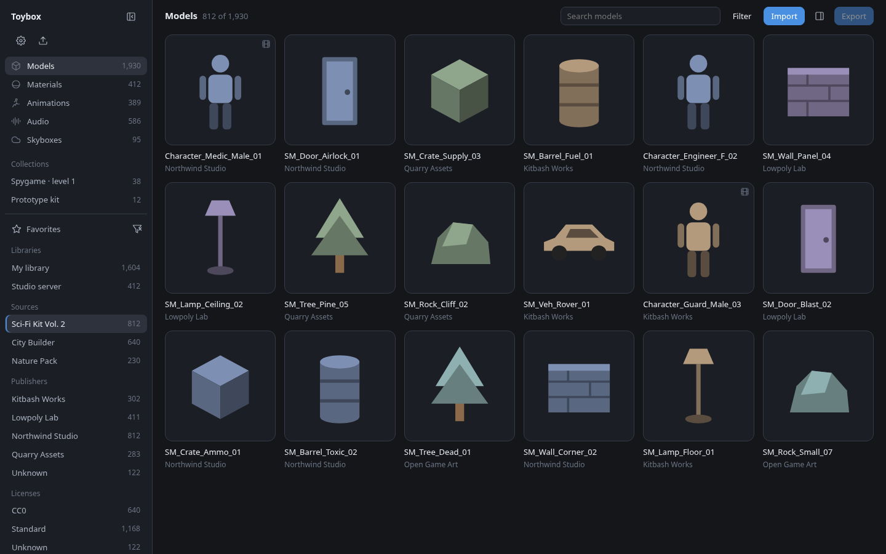
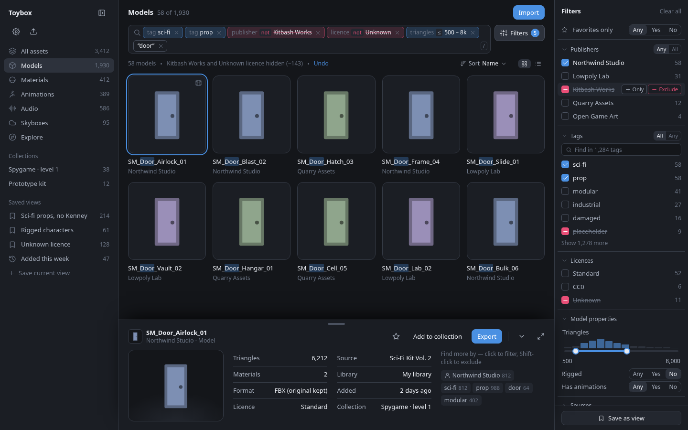
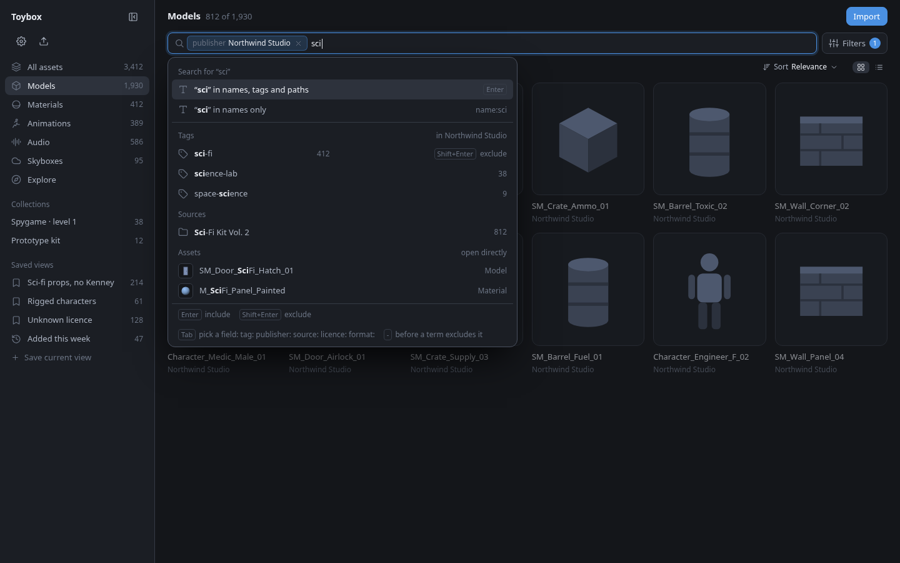
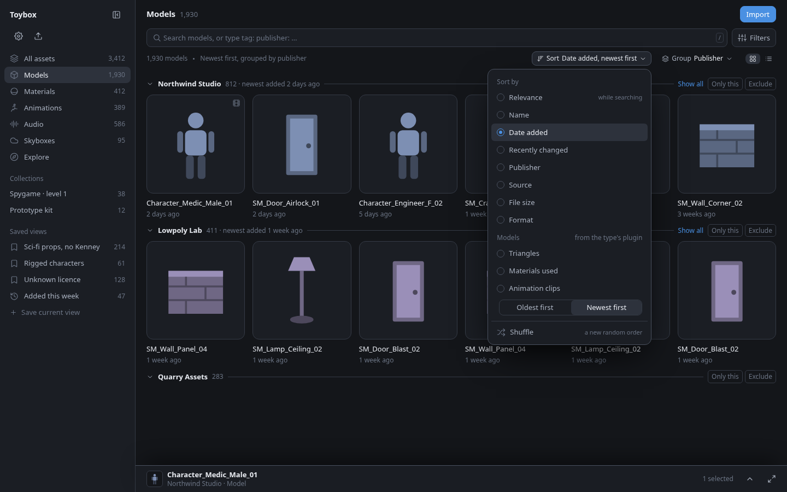
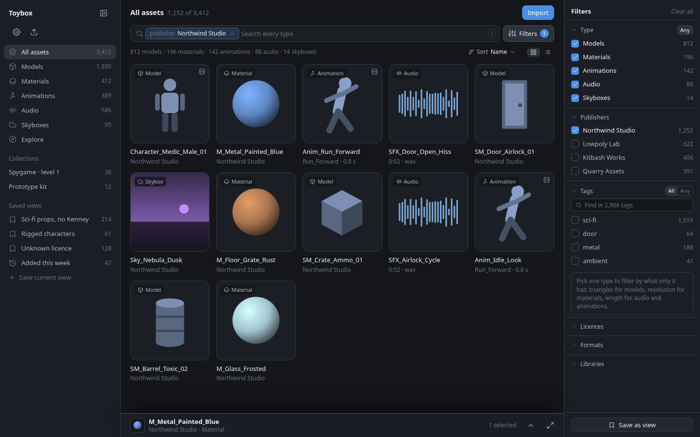
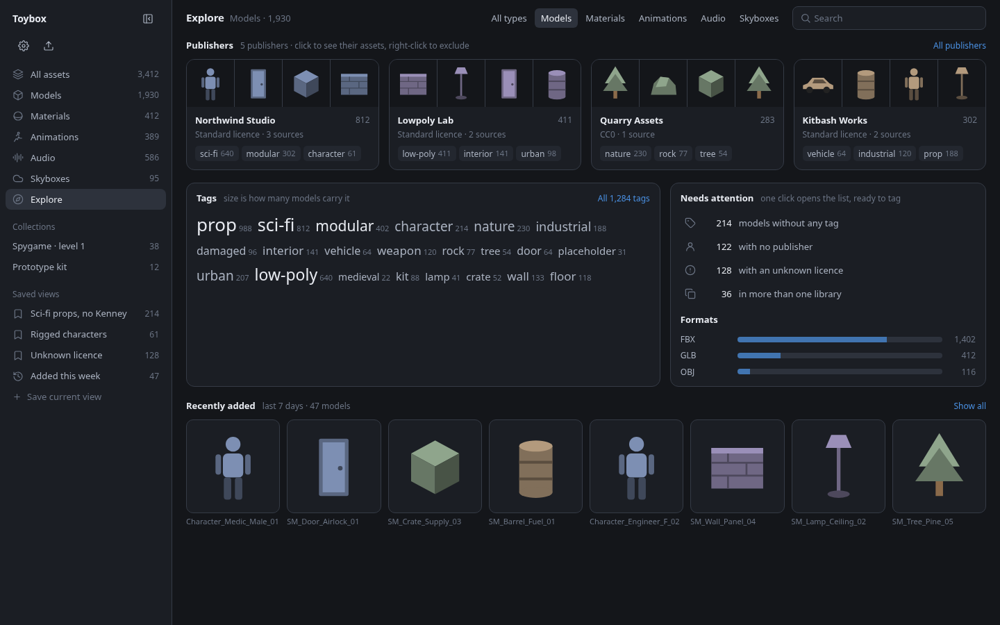
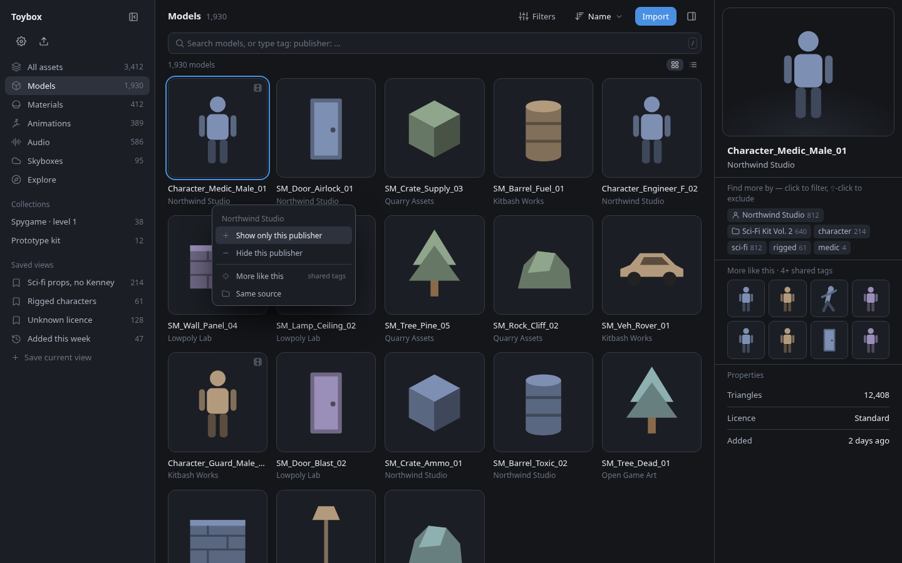

# Finding assets: filter, search, sort and explore

A concept for how people find things in a Toybox library of any size and any asset type. It replaces the include-only facet rail and the name search with one query that can include and exclude, a sort and group control, an "All assets" view across types, saved views, and an Explore page. Nothing here is built yet.

## What is there today



- The rail (`src/components/FacetFilter.tsx`) lists Libraries, Sources, Publishers, Licenses, Formats, Tags and Category with counts. A click narrows to that row; shift-click adds rows. Within a group the rows are OR'ed, tags are AND'ed. A row can never be **excluded**.
- The search box (`src/components/LibraryToolbar.tsx`) is a case-insensitive substring over the name and tags (`text` in `BrowseFilter`, FTS5 trigram index `asset_search` in the backend). It cannot say which field to search, and the filters it works with are not shown next to it.
- The list is always ordered by name (`ORDER BY name COLLATE NOCASE, id` in `infra/store/browse.rs`; `query_assets` only takes `descending`).
- The type switch is a mode: one type at a time. There is no way to see everything from a publisher across models, materials, audio and so on.
- Collections exist, but nothing keeps a query.

## The concept



### 1. One query, shown as a query bar

The search field becomes a full-width **query bar** under the page title. It holds the whole query: free text plus a chip per condition. Every filter set anywhere (rail, right-click, inspector, Explore) appears there as a chip, and can be removed there.

- A chip is `field · value`, blue when it includes, red and struck through when it excludes. Clicking a chip flips include/exclude; × removes it.
- Typing shows suggestions grouped by field, each with its count under the current query: the text itself (names, tags and paths / names only), Tags, Publishers, Sources, Licences, Collections, and matching assets to open directly. **Enter** includes, **Shift+Enter** excludes, **Tab** completes a field name.


- The query can be typed outright, the same syntax `tbx` accepts:

| Typed | Means |
|---|---|
| `door` | text in name, tags or path |
| `name:door` | text in the name only |
| `tag:sci-fi` | has the tag |
| `-publisher:"Kitbash Works"` | not from that publisher |
| `licence:cc0 licence:standard` | either licence (same field = any of) |
| `type:material` | only that type (in All assets) |
| `tris:<8000`, `duration:2..10` | a numeric property the type declares |
| `is:favorite`, `in:"Prototype kit"`, `has:no-tags` | user state, collection, missing metadata |

### 2. Filters with include and exclude

The rail moves out of the navigation sidebar into its own **Filters pane on the right edge** of the window. Its **Filters** button sits at the end of the search row, beside the query bar, with a badge for the number of conditions; on narrow windows the pane stays the existing drawer. The left sidebar keeps only navigation: types, collections, saved views.

- Every row has three states: off, **include** (✓), **exclude** (−). Hovering a row shows *Only* and *Exclude*; click toggles include, Alt-click excludes.
- Each group has a match mode where it makes sense: Publishers *Any*, Tags *All / Any*. Exclusions always apply (an item with an excluded tag is gone, whatever else matches).
- Counts are what the row would give under the rest of the query, so a row never leads to an empty list without saying so.
- Long groups (tags) have a find field, as today, and show the most used and the chosen rows.
- **Type-specific groups** come from the type's plugin: a range with a histogram (triangles, texture size, duration), and Any/Yes/No switches (rigged, has animations, loops). They show only when one type is in view.
- A summary line under the query says what the exclusions remove ("Kitbash Works and Unknown licence hidden (−143)") with Undo, so a forgotten exclusion is visible.

### 3. Sort and group

Sorting is part of the content, not the page header: the **result line** under the search bar holds the count and what is hidden, then **Sort** and **Group** buttons and the grid/list switch. Sort opens:

- Sort by: Relevance (only while searching), Name, Date added, Recently changed, Publisher, Source, File size, Format, and keys the type's plugin declares (Triangles, Materials used, Clip length, Duration, Resolution).
- Direction, worded for the key ("Newest first", "A → Z", "Largest first").
- Group (its own button): None, Publisher, Source, Library, Type, Category, or a tag prefix (`biome:`). Each group has a header with its count and *Only this* / *Exclude*, and can collapse.
- Shuffle: a new random order, for browsing.

The sort is remembered per type.



### 4. All assets

An **All assets** entry above the types shows every type in one grid. Type becomes a filter group like any other, tiles carry a small type label, and the summary counts per type. Shared fields (publisher, source, licence, format, tags, library, favourite, collection) filter across types; type-specific groups appear once a single type is chosen.



### 5. Saved views

**Save as view** keeps the query, sort and grouping under a name in a *Saved views* group of the sidebar, with a live count. A view is a smart collection: it updates as the library changes. Built-in views can ship with it ("Added this week", "Unknown licence"). Views live in `user.db` next to collections; a view may also be saved into the library so a team shares it.

### 6. Explore

An **Explore** page for when you don't know what to search for, per type or for all:

- Publishers as cards: a strip of previews, count, licences, top tags. Click shows only that publisher; right-click excludes.
- A tag cloud sized by use.
- **Needs attention**: items without tags, without publisher, with unknown licence, in more than one library — each opens the list ready to tag (with the existing Tag… dialog).
- Formats as bars, and Recently added.

And from any asset: right-click a tile's publisher/source for *Show only* / *Hide*; the inspector gets **Find more by** chips (publisher, source, each tag, with counts; click filters, Shift-click excludes) and **More like this** (items sharing the most tags).





### 7. Preview tray

The inspector pane on the right is replaced by a **preview tray** at the bottom of the content, between the two side bars, so the right side is free for filters.

- **Collapsed**: one line with the thumbnail, name, publisher and type, and buttons to open the tray or the full view.
- **Open**: preview, properties, *Find more by* chips and the actions (favourite, add to collection, export). Everything the inspector shows today (viewers, variants, lighting, plugin panels, transfer) moves into it.
- **Expanded**: opens the existing full view of the asset.

The tray floats over the grid, and the grid keeps bottom padding equal to the tray's height, so scrolling still reaches the last row.

## Data model

The query the window sends replaces the flat arrays of `BrowseFilter` (`src/domain/browseQuery.ts`) with conditions that can be negated, plus the order:

```schema
## BrowseQuery | What the window asks for (replaces BrowseFilter)
types | string[] | not null | empty = every type (All assets); one entry = today's mode
text | TextTerm[] | | free-text terms, each with scope name \| tags \| path \| any and negate
conditions | Condition[] | | field conditions, see below
favorites | any or yes or no | default any |
collection | string | | as today
libraries | string[] | | as today
sort | SortKey | not null | key and direction
group | GroupKey | | none, publisher, source, library, type, category or a tag prefix
visibility | VisibilityRules | not null | unchanged

## Condition | One chip
field | text | not null | source, publisher, license, format, category, tag, or a plugin property key
include | string[] | | rows chosen to include
exclude | string[] | | rows chosen to exclude
match | any or all | default any | all only for tags
range | {min, max} | | numeric properties only

## SortKey
key | text | not null | relevance, name, added, changed, publisher, source, size, format, or a plugin property key
descending | boolean | default false |
seed | integer | | for shuffle

## saved_views | In user.db, next to collections
name | text | pk |
query | json | not null | a BrowseQuery without visibility
type | text | | the type it was saved on, or null for All assets
position | integer | not null | order in the sidebar
```

`Filter` in `src/domain/facets.ts` keeps one `Set` per field today; it becomes `{ include: Set, exclude: Set, match }` per field, and `applyFilter` (used by tests and tools) follows.

## Backend impact

All in `src-tauri/crates/toybox-core/src/infra/store/browse.rs` and `mod.rs` unless named.

- **Exclude.** `a.publisher NOT IN (…)` for column fields; `NOT EXISTS (… asset_tags … OR … user_tags …)` for tags. Counts for a row stay a `facets` read when the query has only includes; with exclusions they need a count over the remaining rows (as `count_assets` does now for non-cheap filters). The driver logic is unchanged: an exclusion never drives.
- **Tags Any.** `EXISTS (… tag IN (…))` instead of one `EXISTS` per tag.
- **Field-scoped text.** The FTS5 table `asset_search(name, tags)` already has the columns; `name:` uses a column filter. Paths need a third column (`rel_path`), which is a catalog `SCHEMA_VERSION` bump.
- **Sort keys.** `name` is indexed today (`assets_browse`, and `merged` in the browse index). New keys need columns: `added_at` (set at import; for existing rows, from the change log `revision` order as a stand-in), `changed_at` (from `revision`), `byte_size`. Sorting by publisher/source/format uses the existing `(type, publisher)` etc. indexes extended with `name, id`. Each sorted key needs an index of the form `(type, key, name, id)` so a page stays an index walk; the browse index `merged` stays name-ordered and is used only for the plain name sort.
- **Plugin properties.** A type declares filterable and sortable properties (`key`, label, `number` or `boolean`, unit) in its asset-type contract (`docs/asset-types.md`); the importer writes them to a new `asset_props(asset_id, key, num, text)` table with an index on `(key, num, asset_id)`. Range histograms are one `GROUP BY` bucket query per property.
- **All assets.** `a.type = ?` becomes `a.type IN (…)` or is dropped; the unconstrained path walks `merged` without the `type = ?1` prefix. Counts per type already exist (`type_counts`).
- **Group by.** The page query orders by the group key first; group headers and their counts come from a `facet_counts`-style call for that field under the query.
- **Relevance.** FTS5 `bm25()` when the driver is the text search; otherwise name order.

`tbx` takes the same query string (`tbx list 'tag:sci-fi -publisher:"Kitbash Works" sort:added-'`), parsed by one shared parser in `toybox-core`, so the app's query bar and the CLI agree.

## Order of work

1. Exclude and Any/All in the backend and `BrowseFilter`, three-state rows in the rail. Biggest gain, no schema change.
2. Query bar with chips and suggestions (suggestions reuse `search_tags` and `facet_counts`), the shared query parser, `tbx` support.
3. Sort keys `added`, `changed`, `size`, publisher, source; group by. Needs the new columns and indexes (catalog schema bump).
4. All assets and saved views.
5. Plugin-declared properties (`asset_props`), ranges and type-specific sort keys.
6. Explore page and "Find more by" / "More like this" in the inspector.

The screens are in the prototype *Filter, search, sort and explore all asset types* on the project canvas.
